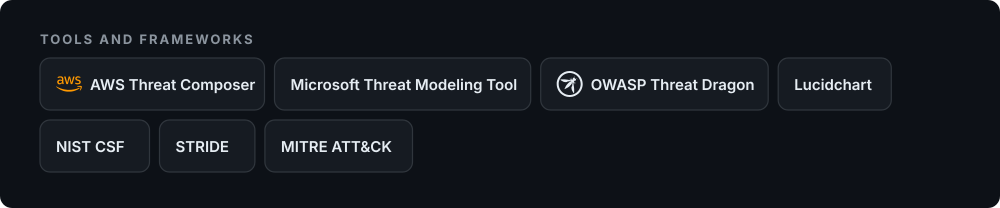

# Risk Assessment and Compliance

**Threat modeling and security controls for a fictional healthcare organization**

CIT 45100 · Purdue University Indianapolis

---

## At a glance

| 3 parts | 10 threats modeled | 6 security controls | 12 deliverables |
|:---:|:---:|:---:|:---:|
| Inventory, threat model, controls | STRIDE classified | Preventive, detective, corrective | Diagrams, catalogs, case studies |

## Overview

A full risk assessment of **Health Network**, a fictional healthcare organization that handles patient data, payment processing, and medical messaging. The course focused on government and industry frameworks, threat modeling, security control design, and real world risk analysis.

## The three parts

**Part 1: Assets and threats.** Built the asset inventory, process map, and first threat list. Compared Microsoft Threat Modeling Tool and AWS Threat Composer side by side, covering the advantages and limits of each for modeling Health Network.

**Part 2: Threat model.** Expanded the model in AWS Threat Composer with full STRIDE classification, built data flow diagrams in Lucidchart, and mapped mitigations for 10 threats: SQL injection, DDoS, ransomware, physical theft, and insider threats.

**Part 3: Security controls.** Finished a control catalog with six controls across preventive, detective, and
